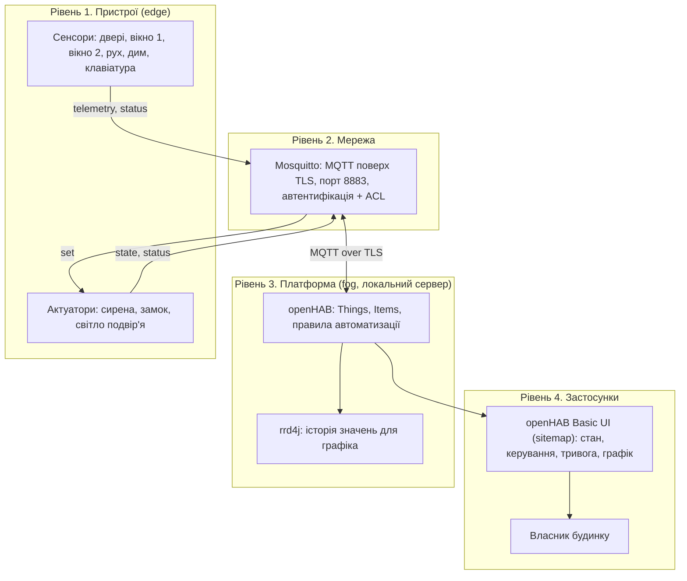
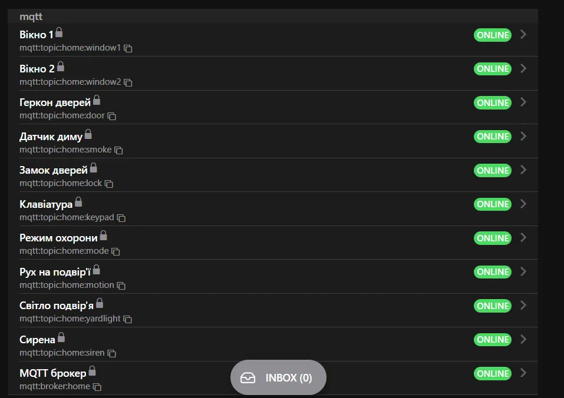
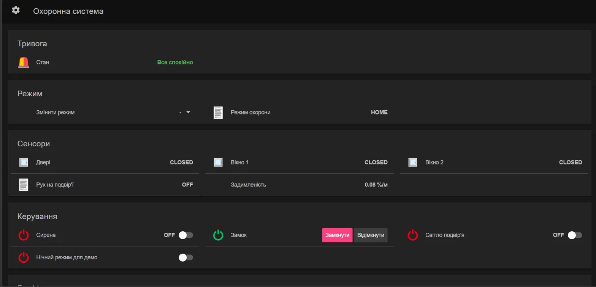
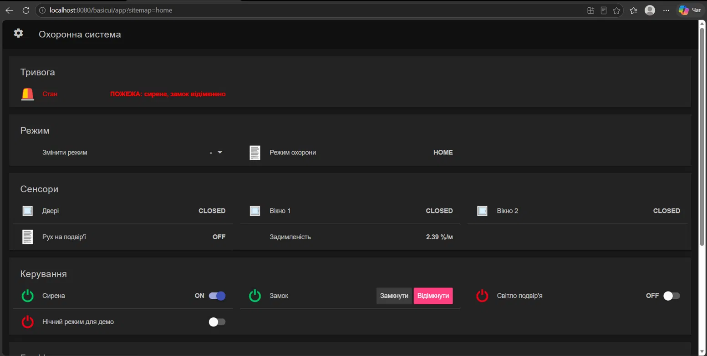
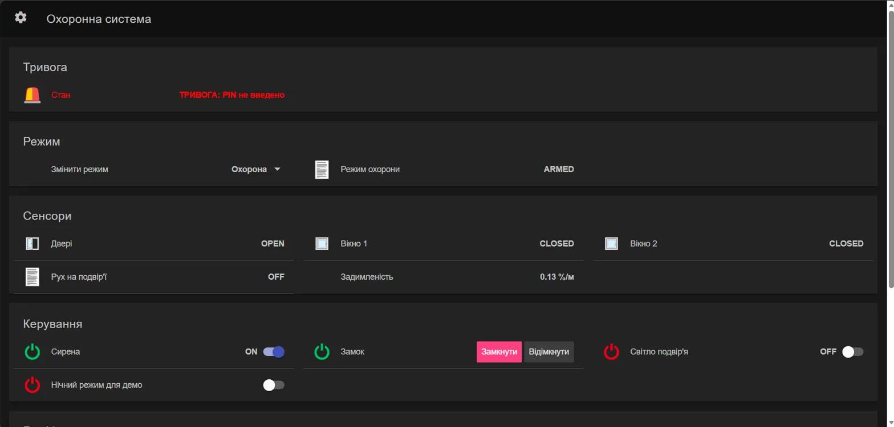
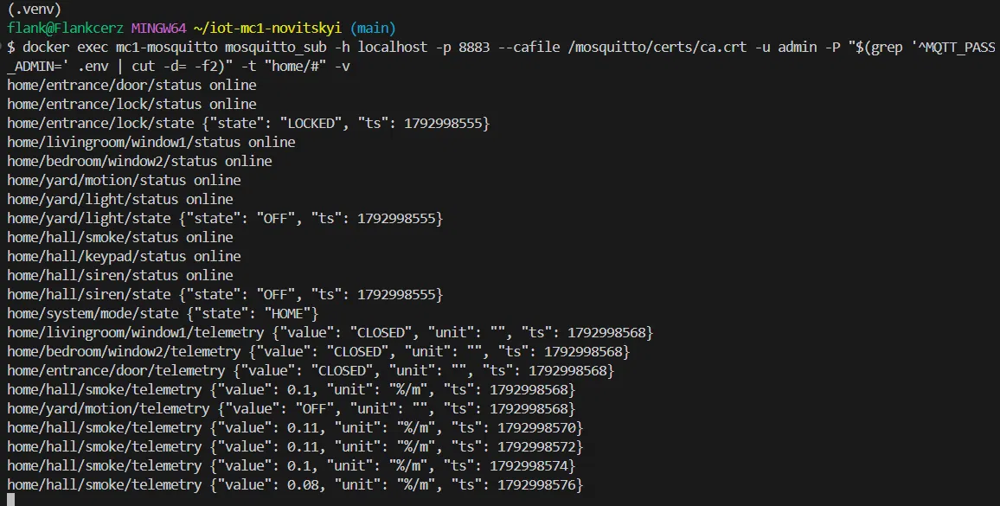
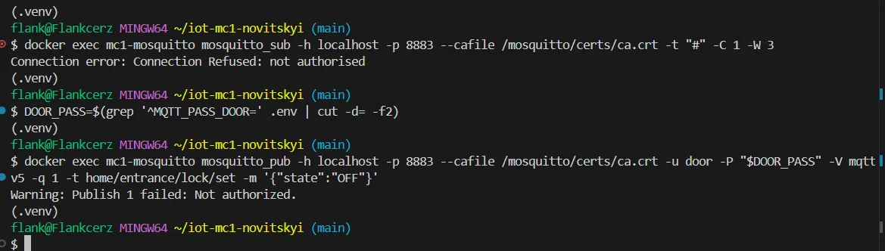

# Охоронна система приватного будинку (IoT, варіант 3)

**Відео-демонстрація:** [ПОСИЛАННЯ_НА_ВІДЕО](ПОСИЛАННЯ_НА_ВІДЕО)

Модульний контроль 1 «Вступ до IoT», дисципліна «Технології IoT та SMART-технології».
Студент: Новіцький Віталій Володимирович, ІК-42 Варіант 3.

## 1. Опис системи

Охоронна система приватного будинку з режимами «Вдома» (`HOME`) та «Охорона» (`ARMED`).
Система стежить за дверима, двома вікнами, подвір'ям і димом, керує сиреною, замком дверей
і світлом на подвір'ї. Пристрої симулюються на Python (`paho-mqtt`), обмінюються даними через
захищений брокер Mosquitto, а логіка автоматизації й інтерфейс працюють в openHAB.

Система повністю відтворюється з репозиторію: `docker compose up -d` плюс кілька команд із розділу 9.

## 2. Архітектура (чотири рівні)



### Де обробляються дані (edge / fog / хмара)

- **Edge (пристрої):** симулятори лише вимірюють і публікують. Клавіатура не надсилає PIN у відкритому вигляді, вона хешує його (SHA-256) ще на пристрої. Актуатори самі підтверджують виконання команди у `.../state`.
- **Fog (локальний сервер):** брокер Mosquitto і openHAB працюють на одному локальному хості. Вся логіка тривог (таймер 30 с, дим, нічне світло) виконується тут, тому охорона працює без інтернету й без хмари, а затримка мінімальна.
- **Хмара:** не використовується. Охоронна логіка не повинна залежати від зовнішнього сервісу. Хмару можна додати для віддалених сповіщень і довгого архіву.

### Чому MQTT, а не CoAP, HTTP, Zigbee чи LoRaWAN

Для охоронної системи потрібні події в реальному часі від багатьох пристроїв і надійна доставка команд, а також індикація втрати пристрою. MQTT дає модель publish/subscribe з одним брокером, рівні QoS, retained-статуси та Last Will, яким брокер сам повідомляє про зникнення пристрою, і ці механізми прямо використані в системі. HTTP працює за схемою запит-відповідь, тож для подій потрібен був би постійний опитувальний цикл. CoAP добре підходить для обмежених пристроїв, але має слабшу екосистему інтеграцій з openHAB і не має вбудованого аналога Last Will. Zigbee потребує окремого радіо-обладнання й координатора, а LoRaWAN розрахований на рідкісні маленькі повідомлення на великі відстані й не підходить для миттєвої тривоги в межах будинку.

## 3. Пристрій

| Пристрої | Тип | MQTT-користувач | Топіки (база) |
|---|---|---|---|
| Геркон дверей | сенсор | `door` | `home/entrance/door` |
| Вікно 1 | сенсор | `window1` | `home/livingroom/window1` |
| Вікно 2 | сенсор | `window2` | `home/bedroom/window2` |
| Рух на подвір'ї | сенсор | `motion` | `home/yard/motion` |
| Датчик диму | сенсор | `smoke` | `home/hall/smoke` |
| Клавіатура (PIN, режим) | сенсор/ввід | `keypad` | `home/hall/keypad` |
| Сирена | актуатор | `siren` | `home/hall/siren` |
| Замок дверей | актуатор | `lock` | `home/entrance/lock` |
| Світло подвір'я | актуатор | `light` | `home/yard/light` |
| Режим охорони | системний | запис: `keypad`, `openhab` | `home/system/mode` |

Плюс користувачі `openhab` (платформа) та `admin` (адміністратор), разом 11 облікових записів.

Симулятори дають реалістичні дані: дим моделюється як фон + шум + плавний тренд до цільового рівня
(`simulator/devices.py`, клас `Smoke`), а контактні датчики надсилають стан при зміні та періодичний heartbeat.

## 4. MQTT: топіки та формат

Структура: `home/<зона>/<пристрій>/<тип>`.

| Топік | Напрямок | Retain | Опис |
|---|---|---|---|
| `<база>/telemetry` | пристрій → брокер | ні | дані сенсора |
| `<база>/set` | openHAB → актуатор | ні | команда |
| `<база>/state` | актуатор → брокер | так | підтверджений стан |
| `<база>/status` | пристрій → брокер | так | `online` / `offline` (Last Will) |
| `home/system/mode/set` | клавіатура / openHAB | ні | запит зміни режиму |
| `home/system/mode/state` | openHAB | так | поточний режим |

Формат повідомлень (JSON):

```json
{"value": 0.22, "unit": "%/m", "ts": 1792965599}
{"state": "ON"}
```

Для клавіатури `value` містить SHA-256 введеного коду, а не сам код (`"unit": "sha256"`).

### QoS, retain, Last Will

- **Telemetry, QoS 1.** Події «двері відкрито» чи «дим» запускають тривогу, тому їх не можна губити. QoS 2 надмірний, бо дані сенсорів періодично повторюються, а дублікат нешкідливий.
- **Команди (`set`), QoS 1.** Команду треба гарантовано доставити. Повторна доставка безпечна, бо команда ідемпотентна («ON» вдруге нічого не змінює). QoS 2 дав би зайві накладні витрати.
- **Retain** для `status` і `state`: новий підписник (наприклад, перезапущений openHAB) одразу знає поточний стан.
- **Last Will:** кожен пристрій реєструє `offline` у `.../status` (retain, QoS 1). Якщо симулятор аварійно завершується, брокер сам публікує `offline`, і Thing в openHAB переходить в OFFLINE.

## 5. openHAB

Конфігурація лежить у `openhab/conf/` і відтворюється з репозиторію:

- `templates/mqtt.things.template`: шаблон Things (мосту брокера й усіх пристроїв). Справжній `mqtt.things` з паролем генерує `setup.sh` і він не потрапляє в git;
- `conf/items/home.items`: Items;
- `conf/sitemaps/home.sitemap`: інтерфейс (стан тривоги, режим, сенсори, керування, графік);
- `conf/persistence/rrd4j.persist`: збереження історії задимленості;
- `conf/rules/security.rules`: правила автоматизації.

Доступність пристроїв береться з `status` (`availabilityTopic`), тому відключення симулятора видно в UI.

## 6. Правила автоматизації

Інтервали відповідають умові завдання (30 с, 2 хв), прискорення для демонстрації не застосовувалось.

1. **Охорона: двері/вікно.** У режимі `ARMED` відкриття дверей або вікна запускає таймер на 30 с.
   Якщо за цей час не введено правильний PIN, вмикається сирена й тривога. Правильний PIN (порівнюється хеш)
   скасовує таймер і повертає режим `HOME`.
2. **Дим.** При задимленості вище 2,0 %/м за будь-якого режиму вмикається сирена й відмикається замок
   (евакуація). При падінні нижче 0,5 %/м тривога скидається.
3. **Рух на подвір'ї вночі.** З 22:00 до 06:00 (часовий пояс `Europe/Kyiv`) рух вмикає світло на 2 хвилини.
   Для демонстрації вдень є перемикач «Нічний режим для демо».

Пороги диму підібрані для демонстрації й не є нормативними значеннями.

## 7. Безпека

- Анонімний доступ вимкнено (`allow_anonymous false`).
- Окремий користувач і пароль для кожного пристрою, для openHAB та адміністратора.
- ACL за принципом найменших привілеїв (`mosquitto/config/acl`): сенсор пише лише у свої `telemetry` і `status`,
  актуатор читає лише свій `set`, а пише лише `state` і `status`. Жоден сенсор не може керувати замком,
  а режим охорони можуть змінювати лише `keypad`, `openhab` та `admin`.
- TLS на порту 8883 з власним CA (`certs/generate.sh`). Порт 1883 не відкритий і не опублікований.
- Секрети поза репозиторієм: паролі генерує `setup.sh` у `.env`, у git лежить лише `.env.example`.
  Приватні ключі, сертифікати, `passwd`, `mqtt.things` і `pin.map` в `.gitignore`.
- PIN не зберігається в репозиторії й не потрапляє в логи: у `.env` лежить сам код, openHAB отримує лише його SHA-256
  (`openhab/conf/transform/pin.map`, генерується `setup.sh`), а клавіатура надсилає в MQTT лише хеш.
  Хеш чотирицифрового коду можна підібрати, тому для реальної системи потрібні HMAC із сіллю або одноразовий nonce.

### Модель загроз STRIDE

| Категорія | Загроза | Захід протидії |
|---|---|---|
| **S**poofing | Зловмисник підключається як сенсор із вкраденим або вгаданим паролем | Окремий пароль для кожного пристрою, TLS, ACL обмежує вкрадений обліковий запис лише його топіками |
| **T**ampering | Скомпрометований сенсор публікує команду в `lock/set` або змінює режим охорони | ACL забороняє запис у чужі топіки (перевірено: `Publish failed: Not authorized`); TLS захищає від підміни трафіку |
| **R**epudiation | Неможливо визначити, хто надіслав команду або підключився | Кожен пристрій має власного користувача; брокер логує кожне підключення з ім'ям користувача і відмови (`not authorised`, `rc135`) |
| **I**nformation disclosure | Прослуховування мережі, крадіжка PIN або паролів | TLS на 8883, PIN передається лише як SHA-256, паролі й ключі поза git |
| **D**enial of service | Затоплення брокера підключеннями або повідомленнями | Анонімні підключення заборонені, назовні відкритий лише 8883; обмеження швидкості й кількості підключень не налаштовано (напрямок для розвитку) |
| **E**levation of privilege | Скомпрометований пристрій намагається отримати права адміністратора або керувати чужими пристроями | Принцип найменших привілеїв в ACL, окремий admin, openHAB може писати лише `.../set` і `home/system/mode/state` |

## 8. Знімки екрана








## 9. Запуск

Потрібні: Docker Desktop, Git (Git Bash на Windows), Python 3.10+, доступ до інтернету при першому запуску
(openHAB завантажує додатки).

```bash
git clone https://github.com/Flankcerz/iot-mc1-novitskyi.git
cd iot-mc1-novitskyi
export MSYS_NO_PATHCONV=1        # лише Git Bash на Windows
bash certs/generate.sh           # власний CA і сертифікат брокера
bash setup.sh                    # .env, паролі брокера, truststore, mqtt.things, pin.map
docker compose up -d
```

Перший старт openHAB триває 3-5 хвилин. Відкрийте `http://localhost:8080`, створіть обліковий запис адміністратора
(він не зберігається в репозиторії), потім інтерфейс: `http://localhost:8080/basicui/app?sitemap=home`.

Симулятор пристроїв (окремий термінал):

```bash
cd simulator
python -m venv .venv
.venv\Scripts\activate           # Windows; на Linux/macOS: source .venv/bin/activate
pip install -r requirements.txt
python devices.py
```

Одночасно має працювати лише одна копія симулятора (однакові `client_id`).

### Сценарії для демонстрації правил

| Команда | Що перевіряє |
|---|---|
| `python devices.py --scenario intrusion` | правило 1: охорона, двері відкриті, PIN не введено, через 30 с сирена |
| `python devices.py --scenario intrusion_pin` | правило 1: правильний PIN вчасно, сирена не вмикається |
| `python devices.py --scenario intrusion_wrong_pin` | правило 1: хибний PIN |
| `python devices.py --scenario window` | правило 1: відкрито вікно при охороні |
| `python devices.py --scenario fire` | правило 2: дим, сирена і відмикання замка |
| `python devices.py --scenario night_motion` | правило 3: рух, світло на 2 хв (вдень увімкніть «Нічний режим для демо») |
| `python devices.py --scenario reset` | скидання дверей і режиму |

Перевірка безпеки (з кореня проєкту, Git Bash):

```bash
docker exec mc1-mosquitto mosquitto_sub -h localhost -p 8883 --cafile /mosquitto/certs/ca.crt -t "#" -C 1 -W 3
```

## 10. Відомі обмеження

- У Docker на Windows Mosquitto попереджає про права до `passwd` і `acl` (власник не `mosquitto`). Брокер працює, попередження не критичне.
- Хеш PIN підбирається (див. розділ 7).
- Хмарна частина відсутня, всі дані лишаються локально.